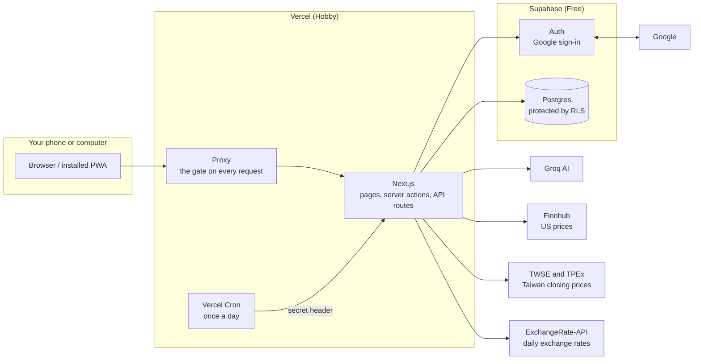

# Architecture

The big picture of My Schedule Manager: what the pieces are, how data moves, and how it stays private.

Status: **updated at the end of Phase 6.** Parts marked *planned* describe the design for later phases and don't exist yet.

## 1. System diagram

**In one sentence:** every request passes the gate, the app talks to the database as you (so the database's own rules apply), and the browser never holds a secret.

## 2. Component cards

### Auth (built)
- **Does:** signs you in with Google, and throws out anyone who isn't the one allowed account.
- **Owns:** the login session, stored in cookies. Supabase keeps the account record.
- **Called by:** the proxy on every page, and again by pages and server actions.
- **If it fails:** you're treated as signed out and sent to the login page. It never fails open.

### App shell and settings (built)
- **Does:** the sidebar, bottom tabs, status strip, language and timezone.
- **Owns:** the `settings` table and a language cookie.
- **Called by:** every signed-in page.
- **If it fails:** the page shows an error state with a retry button. Your data isn't affected.

### Schedule Loop (built)
- **Does:** weekly templates, the actual blocks on real dates, check-offs, Rest Days and Shields.
- **Owns:** `loop_templates`, `template_activations`, `template_blocks`, `block_instances`, `rest_days`.
- **Called by:** the Loop pages. Later, the game engine and the Oracle through proposals.
- **If it fails:** you see an error and nothing is saved. Existing logs are safe, and generation can safely run again.

### Calendar (built)
- **Does:** month, week, day and agenda views of blocks and one-off events. Deadlines arrive with tasks in Phase 3.
- **Owns:** `events`.
- **Called by:** the Calendar page, which asks `/api/calendar` for the dates on screen.
- **If it fails:** only the calendar shows an error. Its heavy code downloads only on this page.

### Game Engine (built)
- **Does:** pure maths for XP, Power, levels and tiers, in `engine.ts`. Every formula is written above its function, and your spec's worked examples are its tests.
- **Owns:** `game_ledger` (every change ever) and `game_state` (a fast copy of the current totals).
- **Called by:** check-offs, corrections and Day Closeout.
- **If it fails:** nothing is written, because each change lands whole or not at all. XP and Power can always be rebuilt from the ledger, and a test proves they match.

### Day Closeout, "The Reckoning" (built)
- **Does:** closes each finished day exactly once: unlogged blocks become skipped, then losses, streak and counters apply, and a summary is written.
- **Owns:** `closed_days`, `daily_summaries`.
- **Called by:** your first request of a new day, and the daily cron as backup. The cron also keeps Supabase Free from pausing.
- **If it fails:** the next request or cron run tries again. `closed_days` allows each date once, so no day can count twice.

### Doom Clock and Focus (built)
- **Does:** countdown to midnight and to the end of the current block, plus a full-screen focus timer that keeps the screen awake.
- **Owns:** a focus-broken count on each block.
- **Called by:** the status strip, which opens the full clock, and the Focus link on a block.
- **If it fails:** only the visual stops. No XP or Power depends on it, and leaving focus mode has no penalty.

### Home lobby and warrior (built, art partly finished)
- **Does:** shows the full-screen citadel, the living-painting dragon and the warrior for your tier. His aura, eyes, cracks and color follow your Power state. Lightning, fog, embers and his lines add to it, along with the level-up and tier-up cinematics.
- **Owns:** nothing in the database. It only reflects the game state. Art is in `public/art`, and his lines are in `lines.ts` and the messages files.
- **Called by:** the Home page and status strip. His speech box and key-moment lines run on every page.
- **If it fails:** purely decorative, with your data unaffected. On phones it uses fewer particles, and at the Off motion setting the art holds still.

### Sound (built, voice not yet)
- **Does:** thunder, wind and game sound effects, made live by the browser with no audio files or music licences. His Japanese voice clips will play through the same code once they exist.
- **Owns:** your mute choice, saved in this browser only.
- **Called by:** the lobby, and anything that marks a key moment.
- **If it fails:** phones block sound until the first tap, so nothing depends on it. The line is on screen either way.

### Section places (built, code-drawn for now)
- **Does:** gives each section its own place in the same world, with a name and accent color, over the citadel painting recolored to that place's light.
- **Owns:** nothing. The address decides the place.
- **Called by:** the signed-in layout.
- **If it fails:** the section works as normal on a dark background.

### Dashboard (built)
- **Does:** Home's hero, today's timeline and nine widgets you can open, collapse, hide and drag. The spending, portfolio and Oracle widgets are placeholders until their phases.
- **Owns:** `widget_layouts`, one saved layout for your phone and one for desktop.
- **Called by:** the Home page.
- **If it fails:** the page shows an error state with a retry button. If a save fails, your layout returns to what was saved.

### Goals, projects and tasks (built)
- **Does:** Goal → Project → Task. A project's progress comes from its finished tasks, or a number you set. A goal averages its projects, leaving out paused ones.
- **Owns:** `goals`, `projects`, `tasks`, and `progress_snapshots` for the charts.
- **Called by:** the Goals pages, the dashboard and the calendar, which shows tasks with due dates. Later, the Oracle's tools.
- **If it fails:** an error appears and nothing is saved. Deleting a goal also deletes its projects and tasks, after a confirmation.

### Learning tracker (built)
- **Does:** courses, roadmaps and books, each with units and a percent complete. Tag a block with a track to chart your study minutes per week.
- **Owns:** `learning_tracks`, `learning_units`, and the `track_id` tag on blocks and tasks.
- **Called by:** the Learning pages, the dashboard and the block editor.
- **If it fails:** an error appears and nothing is saved. Deleting a track removes the tag from blocks and tasks, but keeps them.

### Habits (built)
- **Does:** daily or weekly targets, with one tap to check in, a heatmap and streaks. They earn no XP, so they can't count twice with blocks.
- **Owns:** `habits`, `habit_checkins`.
- **Called by:** the Habits page and dashboard widget.
- **If it fails:** an error appears and nothing is saved. Nothing else depends on it.

### AI Oracle (built)
- **Does:** chat that reads a short summary of your week and acts only through a fixed list of 13 tools. Reads and goal or task creation happen directly. Schedule changes become proposals you approve, edit or reject.
- **Owns:** `ai_conversations`, `ai_messages`, `ai_proposals`, `ai_actions`, `ai_suggestions`, `ai_rate_limits`, `weekly_reviews`.
- **Called by:** the chat panel, through `/api/oracle/chat`, and the suggestion widget.
- **If it fails:** you get an in-character message, and rate limits retry a couple of times first. Everything else keeps working, because nothing depends on the AI.

### Audit log and Logs page (built)
- **Does:** records every Oracle action, approval, rejection, undo, closeout and correction, shown in **Settings → Logs**.
- **Owns:** `audit_log`, which can only be read and added to.
- **Called by:** the closeout, corrections and every Oracle change.
- **If it fails:** the page shows an error state. Closeouts write their entry in the same transaction as the closeout itself.

### Finance, "The Treasury" (built)
- **Does:** expenses and income in TWD, USD or IDR, repeating transactions, monthly budgets with alerts, and portfolio tracking. Totals are always worked out from the records, never stored.
- **Owns:** `fin_categories`, `transactions`, `recurring_rules`, `budgets`, `trades`, `price_cache`, `fx_rates`, `portfolio_snapshots`.
- **Called by:** Treasury pages, the Home banner and widgets, and the daily cron. The Oracle has no access.
- **If it fails:** a price source being down leaves the last known price showing, and any price or rate can be set by hand. Money trouble in the cron can't stop the day's closeout.

### Vault (built)
- **Does:** organizes links, markdown notes and references to files stored elsewhere, with sections, tags, pins, search and filters. An item can link to one goal, project or learning track, and shows on that page.
- **Owns:** `vault_sections`, `vault_items`.
- **Called by:** Vault pages, and the goal and learning track pages.
- **If it fails:** only the Vault is affected. It holds links, not the files themselves.

### Notifications (planned, Phase 7)
- **Does:** sends the Sunday review push through the browser's Web Push system.
- **Owns:** `push_subscriptions`.
- **Called by:** the weekly cron.
- **If it fails:** you miss the alert, but the review still exists in the app.

## 3. Traced flows

The first two flows are real today. Anything marked *planned* will be corrected as that phase is built.

### "I mark my Study block as done"
1. You tap **Done** on the phone.
2. The request reaches the **proxy**, which checks your session and the allowlist.
3. A **server action** checks your input with Zod and confirms you're the owner.
4. Any overdue closeout runs first, so you're never working from a day that should be closed.
5. The rules check that the block exists, its day has arrived, and it isn't a rest block.
6. The **game engine** works out what the block should be worth, using the streak at the start of the day.
7. It compares that with what the ledger says the block has already earned, and only the difference is applied. That's why changing Done to Partial just adds a reversing row.
8. One database call, `apply_game_commit`, updates the block, adds the ledger row and updates `game_state` together.
9. The whole shell refreshes, and the status strip shows your new XP and Power.

### How blocks get onto your schedule
1. You open the Loop or Calendar. The server finds the last day already generated.
2. For each new day up to the end of next week, it finds which template was active on that date, using `template_activations`.
3. It copies that weekday's blocks into `block_instances`. The database refuses duplicates, so this is safe to repeat.
4. Days already generated are never redone. That's why a block you add today can't appear on a past day, and why a block you edited stays edited.
5. When you edit a template or switch to another, future blocks you haven't logged or edited are replaced. Anything you touched stays.

### "Midnight closeout runs"
1. Either your first request of the day notices that yesterday isn't closed, or Vercel Cron calls `/api/cron/daily` with its secret header.
2. Any days not generated yet are filled in, so a day you never opened still counts.
3. For each unclosed past day, in date order, the engine works out the result. A planned block still running past midnight makes it wait.
4. Unlogged blocks become **skipped**, and each skipped block costs XP and Power.
5. The streak, Power-zero counter and tier-demotion counter update. Rest and Shield days, and days with nothing productive planned, leave all three unchanged.
6. `apply_game_commit` writes everything as one unit: `closed_days`, the blocks, `game_ledger`, `game_state`, `daily_summaries` and `audit_log`. If that date is already closed, the whole thing is refused, so running twice changes nothing.
7. On your next open, the **Reckoning screen** adds up every summary you haven't seen. Dismissing it marks them seen.

### "I fix yesterday's block after closeout"
1. You open yesterday in the Loop within 24 hours of its closeout, and change the block.
2. The day is scored as it stood then, using that day's starting streak and tier. New `correction` rows go into the ledger, and nothing old is edited.
3. That day's summary is recalculated, and the streak is replayed forward from it. XP earned on later days isn't changed.
4. After 24 hours, the change is refused.

### "I ask the Oracle to move my gym session and approve it"
1. You type the request. The server checks you're the owner, and counts it against the limit of 20 a minute.
2. The server sends the rules, a short summary of your week and your last few messages to Groq. Your notes and titles are marked as data, not instructions.
3. The model asks to call `get_schedule` to find the block's id. It can't touch the database: it can only ask, and the server runs the tool.
4. The model asks to call `propose_block_changes`. The server checks the request with Zod, and checks the real block: it must exist, be this week, and be unlogged. The "before" comes from your data, not from the model.
5. It saves that to `ai_proposals`. **Nothing on your schedule has changed yet.**
6. You see a before-and-after card, and tap **Approve**, **Edit** or **Reject**.
7. On approval, the server checks the proposal hasn't passed its 48 hours and the block hasn't changed since. Only then does it change `block_instances`, and write it to `audit_log`.

### "I add NT$120 of food, then buy a stock"
1. You tap **Add**, type 120 on the number pad and tap **Food**. Tapping the category is what saves it.
2. A server action checks the input with Zod. For foreign money it finds the rate for that date and stores the original amount, the rate and the TWD value together, so later rate changes can't rewrite the past.
3. The page refreshes. Totals and budgets are worked out from the records, and a budget at 80% or 100% raises the banner.
4. Adding a trade first replays every trade by date, and refuses it if you'd be selling shares you didn't hold yet.
5. Once the page is on screen, it asks for any price or rate that's out of date, so a slow source never holds the page up. The numbers update when the answer arrives, and today's portfolio value is saved for the history chart.

## 4. Security explained simply

Each layer stops something different, so one failure doesn't expose everything. "Built" means it exists and has tests. Google sign-in and the hook still need a real test once your accounts exist.

1. **Google login only (built).** Blocks password guessing, because there are no passwords to guess. Email sign-up is switched off in Supabase.
2. **Allowlist (built).** Google proves *who* someone is, but anyone can have a Google account. The server compares the email with `ALLOWED_EMAIL`, signs out anyone else and shows "Access denied". If that setting is missing, nobody gets in.
3. **Sign-up gate (built, added beyond the spec).** The allowlist guards our app, but someone could skip the app and talk to Supabase directly with the public key. Two extra locks stop them making an account at all: the Google consent screen is limited to you, and a database hook rejects any other email.
4. **Row Level Security (built).** Rules inside the database itself: you only see rows where `user_id` is yours. Even with a bug in the app or a leaked public key, the database still says no. A test fails if any table is missing RLS.
5. **Server-only secrets (built).** Secrets never get the `NEXT_PUBLIC_` prefix, so they're never sent to the browser. A test scans the browser's code for their names.
6. **Input validation (built).** Zod rejects anything unexpected before it reaches the database, even if someone crafts a request by hand.
7. **Cron secret (built).** Cron endpoints are public URLs, so they require a secret header. Without it the answer is 401.
8. **AI safety (built).** The model only asks to use fixed tools, and each request is re-checked on the server. Tools for logging blocks, money or game settings simply don't exist, so no trick can reach them. Schedule changes wait for your approval. Text from your notes is fenced off as data, so a malicious note can't give it orders, and a limit on tool rounds stops a confused model looping.
9. **Rate limiting (built).** Stops a runaway loop from burning your free AI quota, at 20 requests a minute. It lives in Postgres, because serverless memory doesn't last between requests.
10. **Security headers (built).**
    - CSP tells the browser to run only scripts that carry this request's random nonce, which limits damage from injected code.
    - `X-Frame-Options` stops other sites embedding the app to trick your clicks.
    - `Referrer-Policy` limits what other sites learn about where you came from.
    - `Permissions-Policy` turns off device features the app doesn't use.
11. **Audit log (built).** An append-only record of closeouts and corrections, with AI actions, approvals and undos joining in Phase 4. Even you can't edit or delete rows through the app, so the history can be trusted. The game ledger follows the same rule. Viewing it in Settings arrives with Phase 4.
12. **No personal data in logs (built).** Error paths log nothing personal, because hosted logs are outside the protections above.
13. **Backup (planned, Phase 7).** JSON and CSV export with JSON restore, so a mistake or lost account doesn't mean lost data.

### Preview mode
`AUTH_PREVIEW=true` shows the app without a login, so it can be tested before accounts exist. Your data isn't involved: screens use a temporary in-memory store that disappears when the server stops, and a scripted stand-in plays the AI. A preview-only route, `/api/dev/preview-seed`, resets that store so tests can reach things that normally depend on a real midnight. Both only work outside production builds, and tests prove a production build ignores them.

## 5. Key design choices

- **Dark and private means dynamic.** Every page is rendered fresh per request, because each needs a new CSP nonce and a session check. Next's `cacheComponents` is off for that reason.
- **Chinese fonts come from Google at runtime.** Self-hosting them meant about 240 font files on every build. They load only in Chinese, and only after the page appears, so a slow connection to Google can't hold the page back. The device's built-in Chinese font shows until they arrive.
- **The database is changed only by migration files.** Everything in `supabase/migrations/` can recreate the database from nothing.
- **Schedule times are wall-clock times.** A block at 09:00 is stored as date plus 09:00, with no timezone. Changing timezone changes what "today" means, but never moves a block. The calendar runs in "UTC" mode purely so that it doesn't shift them, and it's told the current time in your timezone.
- **Rules and storage are separate.** The schedule rules (`service.ts`, `logic.ts`) talk to storage through one interface (`repo.ts`), with a Supabase version and an in-memory version. This lets the rules be fully tested without a database.
- **Generation is lazy.** Nothing runs in the background. Blocks are created when you open a schedule page, which suits a free plan with limited scheduled jobs.
- **The ledger stores what really happened.** If a gain is capped because Power is already 100, the row records the amount that was actually applied. That's what lets the totals be rebuilt exactly by adding up the rows.
- **Each database call is a network trip, so calls are kept few.** A page load remembers each read for that one request, closeout skips its work when there's nothing to close, and heavy libraries (charts, calendar, dragging) only download when they're on screen. The database and the Vercel functions both run in Tokyo, close to Taiwan. Keep them in the same region, or every call crosses an ocean.
- **The AI provider is a setting.** The app speaks the common OpenAI chat format, so changing `AI_PROVIDER`, `AI_BASE_URL` and `AI_MODEL` switches provider with no code change. The default is `openai/gpt-oss-20b` on Groq, because it supports tools on the free tier and has no retirement date.
- **The Oracle is kept deliberately short-winded.** Free tiers allow few tokens per minute, so it gets a capped summary, its last 6 messages, and one tool request per step.
- **Charts follow fixed rules.** Colours were checked with a colour-blindness validator rather than chosen by eye. A learning track keeps its colour, there's only ever one axis, and every chart has a table view.
- **Money is rounded to cents at every step.** Computers can't hold values like 0.1 exactly, so every money result passes through one rounding function, and budget percentages are worked out in whole cents.
- **Holdings use the average-cost method.** A sale takes shares out at the average cost so far. Each trade keeps its own exchange rate, so profit in TWD includes any gain from the currency moving.
- **A stock's currency follows its market.** US stocks are in USD and Taiwan stocks in TWD, so one holding's average cost can never mix two currencies.
- **Outside sources sit behind one interface.** `market-data.ts` is the only code that talks to Finnhub, TWSE, TPEx and the rate source. Tests and preview mode use fixed answers instead, so they never touch the network.
- **Categories are archived, never deleted.** Old records must keep their category. A default category stores a key rather than a name, so it shows in your language until you rename it.
- **Painted art, moved by code.** Images are generated once, cut out and compressed by `scripts/prepare-art.mjs`, and animated only with movement and fading, which phones handle smoothly. The dragon is three copies of one picture, with the wings cut out so they can beat around the shoulders.
- **The art never copies its references.** The owner's reference pictures only guided the style, because the code and art are public and nobody here knows who owns them.
- **The Vault treats saved text as untrusted.** Addresses must be `http` or `https`, checked in both the form's schema and the database, so a saved item can't hold a `javascript:` link. Notes are turned into a page on the server with raw HTML and pictures removed, so a pasted note can't run code or tell another site you opened it. The Oracle has no way to read the Vault.
- **Vault search runs in your browser.** The page loads your items once, and each keystroke filters them with no trip to the server. It's instant, and it suits one person's collection.
- **Every game change is one transaction.** The server can't make several database calls safely in a row, because a crash midway would leave things half done. So one Postgres function, `apply_game_commit`, does it all. It also checks a version number, so two tabs can't overwrite each other's changes.
