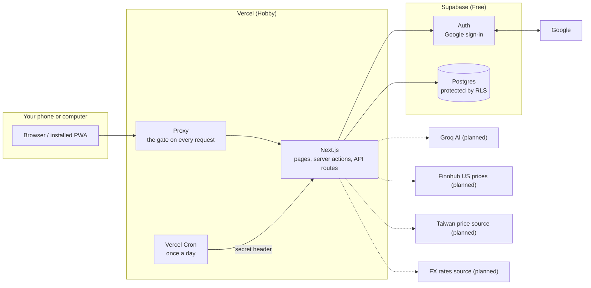

# Architecture

The big picture of My Schedule Manager: what the pieces are, how data moves, and how it stays private.

Status: **v1, written at the end of Phase 0.** Parts marked *planned* describe the design for later phases and don't exist yet.

## 1. System diagram

**In one sentence:** every request passes the gate, the app talks to the database as you (so the database's own rules apply), and the browser never holds a secret.

## 2. Component cards

### Auth (built)
- **Does:** signs you in with Google, and throws out anyone who isn't the one allowed account.
- **Owns:** the login session, stored in cookies. Supabase keeps the account record.
- **Called by:** the proxy on every page, and again by pages and server actions.
- **If it fails:** you're treated as signed out and sent to the login page. It never fails open.

### App shell and settings (built)
- **Does:** the sidebar, bottom tabs, status strip, language and timezone.
- **Owns:** the `settings` table and a language cookie.
- **Called by:** every signed-in page.
- **If it fails:** the page shows an error state with a retry button. Your data isn't affected.

### Keep-alive cron (built, becomes Day Closeout)
- **Does:** touches the database once a day, so Supabase Free doesn't pause the project.
- **Owns:** nothing.
- **Called by:** Vercel Cron at 16:00 UTC (00:00–00:59 Taipei).
- **If it fails:** nothing is lost. Supabase warns by email before pausing, and a paused project can be restored.

### Schedule Loop (planned, Phase 1)
- **Does:** weekly templates, the actual blocks on real dates, and check-offs.
- **Owns:** `loop_templates`, `template_blocks`, `block_instances`, `rest_days`.
- **Called by:** the Loop and Home pages, and the Oracle through proposals.
- **If it fails:** you can't log a block until it recovers. Existing logs are safe.

### Calendar (planned, Phase 1)
- **Does:** month, week and day views of blocks, events and deadlines.
- **Owns:** `events`.
- **Called by:** the Calendar page.
- **If it fails:** only the calendar view is affected. Heavy code loads only on this page.

### Game Engine (planned, Phase 2)
- **Does:** pure maths for XP, Power, levels and tiers.
- **Owns:** no data itself. It calculates and hands results to the ledger (`game_ledger`, `game_state`).
- **Called by:** check-offs and Day Closeout.
- **If it fails:** nothing is written, so the ledger stays correct. `game_state` can always be rebuilt from the ledger.

### Day Closeout, "The Reckoning" (planned, Phase 2)
- **Does:** closes each finished day exactly once: unlogged blocks become skipped, then losses and streaks apply.
- **Owns:** `closed_days`, `daily_summaries`.
- **Called by:** your first request of a new day, and the daily cron as backup.
- **If it fails:** the next request or cron run tries again. `closed_days` stops any day from being counted twice.

### Doom Clock and Focus (planned, Phase 2)
- **Does:** countdown to midnight and the end of the current block, plus a focus timer.
- **Owns:** a focus-broken count on each block.
- **Called by:** the status strip and full-screen view.
- **If it fails:** only the visual stops. No XP or Power depends on it.

### Dashboard (planned, Phase 3)
- **Does:** Home's hero and widgets, with layouts saved separately for phone and desktop.
- **Owns:** `widget_layouts`.
- **Called by:** the Home page.
- **If it fails:** one broken widget shows its own error state rather than taking down the page.

### AI Oracle (planned, Phase 4)
- **Does:** chat that can read your schedule and propose changes through a fixed list of tools.
- **Owns:** `ai_conversations`, `ai_messages`, `ai_proposals`, `ai_actions`.
- **Called by:** the chat panel and the suggestion widget.
- **If it fails:** you get an in-character message. Everything else keeps working, because nothing depends on the AI.

### Finance (planned, Phase 5)
- **Does:** expenses, income, budgets and portfolio tracking.
- **Owns:** the `fin_*`, `transactions`, `trades` and price tables.
- **Called by:** Treasury pages. The Oracle has no access.
- **If it fails:** if a price source is down, you see the last known price and can set one by hand.

### Vault (planned, Phase 6)
- **Does:** organizes links and notes pointing to files stored elsewhere.
- **Owns:** `vault_sections`, `vault_items`.
- **Called by:** Vault pages.
- **If it fails:** only the Vault is affected. It holds links, not the files themselves.

### Notifications (planned, Phase 7)
- **Does:** sends the Sunday review push through the browser's Web Push system.
- **Owns:** `push_subscriptions`.
- **Called by:** the weekly cron.
- **If it fails:** you miss the alert, but the review still exists in the app.

## 3. Three traced flows

The first flow's outer steps (1 and 2) are real today. The rest describes the plan and will be corrected as those phases are built.

### "I mark my Study block as done" (planned, Phase 1–2)
1. You tap **Done** on the phone.
2. The request reaches the **proxy**, which checks your session and the allowlist.
3. A **server action** checks your input with Zod and confirms you're the owner.
4. It updates the block in `block_instances`. The database's RLS rules confirm the row is yours.
5. The **game engine** works out the XP and Power from the formulas.
6. A new row goes into `game_ledger`, and `game_state` is updated.
7. The page refreshes and the status strip shows your new XP and Power.

### "Midnight closeout runs" (planned, Phase 2)
1. Either your first request of the day notices that yesterday isn't closed, or Vercel Cron calls the endpoint with its secret header.
2. For each unclosed past day, in date order, it claims the day in `closed_days`. If that day is already claimed, it stops, so running twice changes nothing.
3. Unlogged blocks become **skipped**.
4. The engine calculates losses, Power, streak and warnings, and writes them to `game_ledger`.
5. It writes a `daily_summaries` row and an `audit_log` row.
6. On your next open, the **Reckoning screen** shows the summary from that row.

### "I ask the Oracle to move my gym session and approve it" (planned, Phase 4)
1. You type the request. The server checks you're the owner and within the rate limit.
2. The server sends a short summary of your week to Groq. Your notes and links are marked as data, not instructions.
3. The model asks to call `propose_block_changes`. It can't touch the database itself.
4. The server re-checks that request with Zod and saves it to `ai_proposals`. **Nothing on your schedule has changed yet.**
5. You see a before-and-after card and tap **Approve**.
6. A server action applies the change to `block_instances` and writes it to `audit_log`.

## 4. Security explained simply

Each layer stops something different, so one failure doesn't expose everything. "Built" means it exists and has tests. Google sign-in and the hook still need a real test once your accounts exist.

1. **Google login only (built).** Blocks password guessing, because there are no passwords to guess. Email sign-up is switched off in Supabase.
2. **Allowlist (built).** Google proves *who* someone is, but anyone can have a Google account. The server compares the email with `ALLOWED_EMAIL`, signs out anyone else and shows "Access denied". If that setting is missing, nobody gets in.
3. **Sign-up gate (built, added beyond the spec).** The allowlist guards our app, but someone could skip the app and talk to Supabase directly with the public key. Two extra locks stop them making an account at all: the Google consent screen is limited to you, and a database hook rejects any other email.
4. **Row Level Security (built).** Rules inside the database itself: you only see rows where `user_id` is yours. Even with a bug in the app or a leaked public key, the database still says no. A test fails if any table is missing RLS.
5. **Server-only secrets (built).** Secrets never get the `NEXT_PUBLIC_` prefix, so they're never sent to the browser. A test scans the browser's code for their names.
6. **Input validation (built).** Zod rejects anything unexpected before it reaches the database, even if someone crafts a request by hand.
7. **Cron secret (built).** Cron endpoints are public URLs, so they require a secret header. Without it the answer is 401.
8. **AI safety (planned, Phase 4).** The model only asks to use fixed tools, which are re-checked on the server. Schedule changes wait for your approval. Text from your notes is treated as data, so a malicious note can't give it orders.
9. **Rate limiting (planned, Phase 4).** Stops a runaway loop from burning your free AI quota. It lives in Postgres, because serverless memory doesn't last between requests.
10. **Security headers (built).**
    - CSP tells the browser to run only scripts that carry this request's random nonce, which limits damage from injected code.
    - `X-Frame-Options` stops other sites embedding the app to trick your clicks.
    - `Referrer-Policy` limits what other sites learn about where you came from.
    - `Permissions-Policy` turns off device features the app doesn't use.
11. **Audit log (table built, used from Phase 2).** An append-only record of AI actions, approvals, undos and closeouts. Even you can't edit or delete rows through the app, so the history can be trusted.
12. **No personal data in logs (built).** Error paths log nothing personal, because hosted logs are outside the protections above.
13. **Backup (planned, Phase 7).** JSON and CSV export with JSON restore, so a mistake or lost account doesn't mean lost data.

### Preview mode
`AUTH_PREVIEW=true` shows the shell without a login so it can be tested before accounts exist. It only works outside production builds, and a test proves a production build ignores it.

## 5. Key design choices

- **Dark and private means dynamic.** Every page is rendered fresh per request, because each needs a new CSP nonce and a session check. Next's `cacheComponents` is off for that reason.
- **Chinese fonts come from Google at runtime.** Self-hosting them meant about 240 font files on every build. They now load only in Chinese, and the phone's built-in Chinese font is the fallback.
- **The database is changed only by migration files.** Everything in `supabase/migrations/` can recreate the database from nothing.
